<div align="center">
  <h1>Mesa de Pedidos</h1>
  <h2>Desafío 1 · Diplomatura en IA Engineering</h2>
  <br>
  
  
  
  
  
  
  
</div>

<br>

---

## 📚 Datos del Proyecto

- **Institución:** ICARO
- **Programa:** Diplomatura Universitaria en IA Engineering
- **Trabajo:** Desafío 1 - Mesa de Pedidos
- **Estudiante:** Mariana Aiello
- **Repositorio:** [AI-Engineering_Desafio1_Mesa-de-Pedidos](https://github.com/Aiello-M/AI-Engineering_Desafio1_Mesa-de-Pedidos)
- **Informe (2 carillas):** [docs/informe.pdf](docs/informe.pdf)

<br>

---

## 📖 Descripción del Proyecto

Este repositorio corresponde al **Desafío 1** de la **Diplomatura Universitaria de Formación Continua en IA
Engineering** (ICARO · UNC · FCEFyN).

La empresa del caso es Ferretería Industrial Andina, una distribuidora mayorista de insumos industriales de
Córdoba. Los clientes mandan sus mensajes por WhatsApp y por mail, y una persona los pasa a mano:
pregunta por un flete, arma un pedido, revisa si el cliente tiene crédito. La mayoría de los mensajes son
rutina, pero algunos necesitan que alguien con autoridad decida.

El proyecto implementa un **grafo de LangGraph** que procesa esos mensajes. Para cada uno:

1. busca al cliente por su CUIT;
2. decide si es una **consulta**, un **pedido** o algo para **derivar** a una persona;
3. si es una consulta, la responde con los 4 PDF de la empresa y cita el documento y la página;
4. si es un pedido, lo arma con el catálogo y el crédito del cliente, aplica las condiciones comerciales
   y lo confirma, lo rechaza o **lo deja en espera para que lo apruebe Gerencia Comercial**.

El LLM se usa solo para entender el texto y redactar las respuestas a las consultas. Python calcula los
montos, los descuentos y el crédito, y aplica las reglas de la empresa.

<br>

---

## 🎯 Objetivo

- Procesar los 20 mensajes de la bandeja y que cada uno termine en el nodo correcto.
- Responder las consultas con la información de los PDF, citando documento y página.
- Calcular los pedidos con las reglas comerciales, sin dejar las cuentas en manos del LLM.
- Frenar los pedidos que necesitan aprobación, guardarlos y poder retomarlos después, aunque el programa
  se haya cerrado.
- Medir el resultado contra el golden set y explicar los casos que fallan.

<br>

---

## ✅ Requisitos Obligatorios

| #   | Requisito                                 | Implementación                                                                                           |
| :-: | :---------------------------------------- | :------------------------------------------------------------------------------------------------------- |
| 1   | **RAG híbrido** (BM25 + denso, con citas) | `retriever.py`: FAISS + BM25 unidos con `EnsembleRetriever`. Las respuestas citan `[documento, p. N]`      |
| 2   | **Dos tools reales**                      | `tools.py`: `consultar_producto` (catálogo y stock) y `verificar_credito` (clientes)                       |
| 3   | **Grafo con estado**                      | `estado.py`: `TypedDict` con un reducer para el log (cada nodo suma su línea)                              |
| 4   | **Bifurcación**                           | `grafo.py`: 3 routers declarados con `add_conditional_edges`, ningún `if` escondido en un nodo             |
| 5   | **Checkpointer**                          | `grafo.py`: `SqliteSaver` sobre `artefactos/checkpoints.sqlite`, un `thread_id` por mensaje                 |
| 6   | **Human-in-the-loop**                     | `nodos.py`: `aprobacion_humana` llama a `interrupt()` con el payload y se retoma con `Command(resume=...)` |
| 7   | **Structured outputs**                    | `esquemas.py`: modelos de Pydantic para clasificar y extraer el pedido, sin `json.loads`                  |
| 8   | **Medición mínima**                       | `evaluar.py`: corre los 20 casos del golden set y guarda `evaluacion.json`                                 |

<br>

---

## 🔄 Funcionamiento General

```text
 mensaje (bandeja.jsonl)
        │
        ▼
 cargar_cliente ──► clasificar ──┬── consulta ──► responder_consulta (RAG + cita) ──► fin
                                 │
                                 ├── derivar ───► derivar_humano ─────────────────────► fin
                                 │
                                 └── pedido ────► extraer_pedido ──► validar_pedido
                                                                         │
                       ┌───────────────┬───────────────┬─────────────────┤
                       ▼               ▼               ▼                 ▼
                   confirmar        rechazar        derivar        aprobacion_humana
                                                                   (interrupt: el programa
                                                                    termina y espera)
                                                                         │
                                                         Gerencia aprueba o rechaza
                                                         (otra terminal, otro día)
                                                                         │
                                                           ┌─────────────┴─────────────┐
                                                           ▼                           ▼
                                                    confirmar_pedido            rechazar_pedido
```

Los 20 mensajes del golden set se reparten de la siguiente manera:

| Termina en           | Mensajes          | Cantidad |
| :------------------- | :---------------- | :------: |
| `responder_consulta` | MSG-001 a MSG-008 |    8     |
| `confirmar_pedido`   | MSG-009 a MSG-012 |    4     |
| `aprobacion_humana`  | MSG-013 a MSG-016 |    4     |
| `rechazar_pedido`    | MSG-017           |    1     |
| `derivar_humano`     | MSG-018 a MSG-020 |    3     |

<br>

---

## 🔀 El Grafo

Salida de `python -m mesa_pedidos.grafo`, que usa `get_graph().draw_mermaid()` (GitHub la dibuja sola):


El grafo tiene **9 nodos y 3 routers**. Las flechas punteadas son las aristas condicionales.

Terminan 4 nodos: `responder_consulta`, `confirmar_pedido`, `rechazar_pedido` y `derivar_humano` (al que
se llega desde `clasificar` y desde `validar_pedido`). `aprobacion_humana` no termina: espera a Gerencia y
después sigue a confirmar o a rechazar.

### Nodos

| Nodo                 | Usa LLM | Función                                                                                          |
| :------------------- | :-----: | :----------------------------------------------------------------------------------------------- |
| `cargar_cliente`     |   no    | Busca el CUIT en `clientes.csv`                                                                  |
| `clasificar`         |   sí    | Decide si es consulta, pedido o derivar (structured output)                                      |
| `responder_consulta` |   sí    | Busca en los PDF y responde citando documento y página                                           |
| `extraer_pedido`     |   sí    | Saca los productos, las cantidades, la forma de pago y el descuento que pide (structured output) |
| `validar_pedido`     |   no    | Usa las dos tools y las reglas para calcular el pedido y decidir qué pasa                        |
| `aprobacion_humana`  |   no    | Frena el pedido con `interrupt()` hasta que Gerencia decida                                      |
| `confirmar_pedido`   |   no    | Arma la confirmación con los montos ya calculados                                                |
| `rechazar_pedido`    |   no    | Arma el rechazo con el motivo                                                                    |
| `derivar_humano`     |   no    | Pasa el mensaje al equipo comercial con el motivo                                                |

### Routers

| Router                 | Después de          | Salidas                                      |
| :--------------------- | :------------------ | :------------------------------------------- |
| `ruta_por_intencion`   | `clasificar`        | `consulta`, `pedido`, `derivar`              |
| `ruta_por_validacion`  | `validar_pedido`    | `confirmar`, `humano`, `rechazar`, `derivar` |
| `ruta_post_aprobacion` | `aprobacion_humana` | `aprueba`, `rechaza`                         |

Los routers solo leen la decisión que dejó el nodo anterior en el estado. No calculan nada.

<br>

---

## 📂 Estructura del Proyecto

```text
AI-Engineering_Desafio1_Mesa-de-Pedidos/
│
├── config.py                 # rutas, modelos y parámetros
├── indexar.py                # arma el índice de los PDF
├── correr.py                 # procesa un mensaje y maneja la aprobación de Gerencia
├── evaluar.py                # mide los 20 mensajes contra el golden set
├── requirements.txt          # librerías con sus versiones
├── .env.example              # copiar como .env y poner la API key
├── .gitignore                # deja afuera .env, .venv y artefactos
├── .gitattributes            # marca los PDF como binarios
├── pytest.ini
├── conftest.py
├── evaluacion.json           # resultado de la medición híbrida (20 casos)
├── evaluacion_densa.json     # resultado de la medición solo con embeddings
├── revision_consultas.md     # las 8 respuestas revisadas a mano
├── README.md
│
├── mesa_pedidos/
│   ├── datos.py                  # lee catalogo.csv y clientes.csv
│   ├── indexado.py               # parte los PDF en chunks y arma el índice FAISS
│   ├── retriever.py              # búsqueda híbrida (embeddings + BM25)
│   ├── tools.py                  # consultar_producto y verificar_credito
│   ├── reglas_comerciales.json   # números de la política, cada uno con su artículo
│   ├── reglas.py                 # cálculo y validación del pedido (sin LLM)
│   ├── esquemas.py               # modelos de Pydantic para el structured output
│   ├── llm.py                    # los prompts de clasificar, extraer y responder
│   ├── estado.py                 # el estado del grafo (con el log y su reducer)
│   ├── nodos.py                  # los 9 nodos
│   └── grafo.py                  # routers, StateGraph y SqliteSaver
│
├── datos/                    # los datos del desafío, sin cambios
│   ├── politicas/            # los 4 PDF de la empresa
│   ├── catalogo.csv
│   ├── clientes.csv
│   ├── bandeja.jsonl         # los 20 mensajes
│   └── golden_set.json       # la respuesta correcta de cada mensaje
│
├── tests/                    # 32 tests que no usan la API
│   ├── conftest.py
│   ├── test_tools_y_reglas.py
│   ├── test_rag.py
│   └── test_grafo.py
│
├── docs/
│   └── informe.pdf           # informe de dos carillas
│
└── assets/                   # capturas de las corridas e imagen de perfil
```

> **Nota:** el `.env` (con la API key) y la carpeta `artefactos/` (índice, chunks y checkpoints) no se
> suben al repositorio. Se generan en los pasos 3 y 4 de la instalación.

<br>

---

## ⚙️ Decisiones de Implementación

### 🔹 Reparto de tareas entre el LLM y Python

| Tarea                                              | Responsable                                      | Motivo                                                    |
| :------------------------------------------------- | :----------------------------------------------- | :-------------------------------------------------------- |
| Clasificar el mensaje                              | LLM (`clasificar`)                               | Hay que entender el texto                                 |
| Sacar los productos y las cantidades               | LLM (`extraer_pedido`)                           | Los clientes escriben como hablan ("200 discos de corte") |
| Responder con la política                          | RAG (`responder_consulta`)                       | La información está en los PDF                            |
| Encontrar la fecha que menciona el cliente         | LLM (`clasificar`)                               | Hay que entender el texto ("el 10 de septiembre")         |
| Calcular si el presupuesto sigue vigente           | Python (`calcular_dias`)                         | Es contar días hábiles, y el LLM se puede equivocar       |
| Revisar el stock y el crédito                      | Tools `consultar_producto` y `verificar_credito` | Son datos de los CSV y no se pueden inventar              |
| Calcular los montos y los descuentos               | Python (`reglas.py`)                             | Tiene que dar siempre lo mismo y poder revisarse          |
| Decidir si se confirma, va a Gerencia o se rechaza | Python (`validar_pedido`)                        | Es la política de la empresa                              |
| Elegir el nodo siguiente                           | Router                                           | Solo pasa una decisión que ya se tomó                     |

Ningún agente llama a las tools: `validar_pedido` las llama en todos los pedidos. El crédito y el stock se
revisan siempre, sin depender de que el modelo se acuerde.

<br>

### 🔹 El RAG

#### ✓ Un chunk por artículo y no por tamaño fijo

Primero probé con tamaño fijo (`RecursiveCharacterTextSplitter` con 1000 caracteres y overlap de 150).
El punto de devoluciones por arrepentimiento quedaba partido en dos:

> - en un chunk, la regla: *"Se acepta devolución de mercadería en su envase original… dentro de los 15 días"*;
> - en otro, la excepción: *"NO se aceptan devoluciones por arrepentimiento de… zapatos de seguridad"*.

Si la búsqueda traía solo el primero, al MSG-003 (que quiere devolver unos zapatos) se le podía contestar
que sí. Como los PDF ya vienen escritos por artículo, partí por ahí. Cada uno de estos es un chunk:

- un artículo de las condiciones comerciales;
- un punto de logística o de devoluciones;
- una ficha técnica.

Los **59 chunks** quedan de entre 136 y 810 caracteres, con estas características:

- un artículo que sigue en la página siguiente queda entero y se cita como "p. 1-2";
- el pie de página que se repite en todas las hojas no se indexa;
- `CHUNK_MAX = 1500` corta un artículo solo si fuera muy largo (con estos PDF no pasa).

Un test muestra que con tamaño fijo la excepción queda separada.

**El nombre del documento al principio de cada chunk:** cada chunk empieza con el título del PDF (y en
las fichas, con el rubro). Por eso un pedazo suelto como "Zona 3: $95.000" sigue diciendo de dónde salió.

<br>

#### ✓ Búsqueda híbrida con `EnsembleRetriever`

- **Embeddings (FAISS):** encuentran textos que dicen lo mismo con otras palabras, como "cuánto tarda" y
  "plazo de entrega".
- **BM25:** busca la palabra exacta, que es lo que sirve para los códigos. Para los embeddings `HE-4330`,
  `HE-4335` y `HE-4410` se parecen mucho (es el caso del MSG-004).
- **Tokenizador de BM25:** no corta en el guion, entonces `he-4330` queda como una sola palabra.
- **Parámetros:** cada búsqueda trae 12 candidatos de cada lado, las dos pesan lo mismo (0,5 y 0,5) y
  quedan los 4 mejores.

**El índice guardado en disco:** se arma una sola vez con `python indexar.py` y queda en
`artefactos/indice_faiss`. Si cambian los PDF, se vuelve a armar con `python indexar.py --forzar`.

**El prompt de las consultas:** recibe los datos del cliente (provincia, categoría, condición de IVA),
porque varias respuestas dependen de quién pregunta: la zona de flete o si le corresponde percepción.
También pide citar `[documento, p. N]` y decir qué información falta si el contexto no alcanza.

<br>

#### ✓ Las fechas

El MSG-005 es del 20/09 y dice:

> *"el presupuesto que me pasaron el 10 de septiembre sigue valiendo?"*

Para contestarlo bien hay que contar días, y eso lo hace Python:

1. la fecha del mensaje viene en la bandeja (20/09);
2. `clasificar` saca la fecha que menciona el cliente en la misma llamada (el campo `fecha_mencionada`);
3. con las dos, `calcular_dias` cuenta los días corridos y hábiles, y cuándo vence un presupuesto (5 días
   hábiles, art. 2): el del 10/09 venció el 17/09;
4. ese cálculo se le pasa al LLM para que lo use en la respuesta.

Si el cliente dice algo impreciso ("la semana pasada", como en el MSG-003), el campo queda vacío y no se
calcula nada. Es mejor no calcular que calcular con un día inventado.

**Los ejemplos de los prompts:** son propios y no salen de los mensajes de la bandeja. Las categorías de
`clasificar` salen de los temas de los PDF y de los tipos de mensaje. Si copiaba las frases de la bandeja,
el sistema iba a andar bien justo con los casos que se usan para medirlo.

**Los modelos:**

- `gpt-4o-mini` con temperature 0, para que las respuestas sean más estables.
- `text-embedding-3-small` para los embeddings.

OpenAI avisó que `gpt-4o-mini` deja de funcionar en la API el 14/01/2027. Para cambiarlo no hay que tocar
el código: alcanza con poner `MODELO_LLM=` y el modelo nuevo en el `.env`.

<br>

### 🔹 Las reglas comerciales

-   **Los números de la política están en un json.** La escala de volumen, los topes, el pedido mínimo, el 3%
por pago anticipado, los días de mora y los impuestos de `condiciones_comerciales_2026.pdf` están en
`mesa_pedidos/reglas_comerciales.json`, cada uno con su artículo. Los pasé a mano porque `validar_pedido`
tiene que funcionar sin LLM. Si cambia la política, se cambia el json y no el código.

-   **Los montos se calculan con `Decimal`**, porque `float` redondea mal (`0.1 + 0.2` da
`0.30000000000000004`). En los textos se muestran con el formato de los PDF: punto para los miles y coma
para los decimales ($927.940,00).

-   **El descuento** es el habitual del cliente más el de volumen (art. 4), con un tope de 20% por producto y
de 15% para las herramientas eléctricas Dewalt, Makita y Bosch (art. 5). Si paga anticipado, se suma un 3%
que no cuenta para el tope (art. 6).

-   **Qué decide `validar_pedido`, en este orden:**

    - **Derivar** si no se puede evaluar: el CUIT no es de un cliente, o un producto no existe o no se pudo
   identificar.
    - **Rechazar** si el cliente está suspendido (más de 60 días de mora) y no paga anticipado. El art. 7
   dice que solo puede comprar con pago anticipado, así que también se rechaza si pide contado.
    - **Mandar a Gerencia** si aparece alguno de estos motivos:
		   - el saldo más el pedido supera el límite de crédito (art. 7);
		   - tiene de 30 a 60 días de mora, pague como pague, porque el art. 7 dice "cada pedido";
		   - pide un descuento mayor al tope de algún producto (art. 5);
		   - no hay stock suficiente (art. 9);
		   - el neto no llega al pedido mínimo (art. 3: no se rechaza, queda en espera);
		   - pide más días de plazo que los que le corresponden, o es categoría C y pide cuenta corriente (art. 6).
    - **Confirmar** si no pasó nada de lo anterior.
      
<br>

-  **Interpretaciones que tuve que tomar**, porque la política no las dice explícitamente:

    - Un cliente categoría C que no dice cómo paga se toma como contado, porque la categoría C no tiene cuenta
  corriente (art. 6).
    - Pedir 19% en una amoladora Dewalt va a Gerencia aunque esté debajo del 20% general, porque para esa marca
  el tope es 15%.
    - La escala de volumen se calcula con el monto de lista. Si se calculara con el monto ya descontado, sería
  circular. El crédito, el pedido mínimo y los impuestos se calculan con el monto con descuento, que es lo
  que se factura.

<br>

### 🔹 Human-in-the-loop: la aprobación de Gerencia

`aprobacion_humana` llama a `interrupt()` con un payload que tiene lo que Gerencia necesita para decidir:

-   razón social, CUIT y categoría;
-   crédito disponible, con el límite y el saldo;
-   días de mora;
-   neto y productos, con el descuento de cada uno;
-   los motivos por los que se frenó;
-   si falta stock, cómo quedaría el pedido con lo que hay;
-   qué pasa si aprueba: se manda solo lo que hay en stock y el resto queda pendiente (art. 9), y si autoriza
  otro descuento, Dewalt, Makita y Bosch siguen con tope de 15%, porque es un acuerdo con el fabricante.

Cuando Gerencia responde, el nodo **vuelve a calcular el pedido** con el stock real y el descuento
autorizado. Si no hay stock de ningún producto, el pedido se rechaza aunque Gerencia lo haya aprobado.
Cualquier respuesta que no sea un "aprobar" claro se toma como rechazo.

Ejemplo, el MSG-016 aprobado con 22%: los discos van al 22%, las amoladoras Dewalt al 15%, se mandan 52
amoladoras y quedan 8 pendientes. El neto baja de $18.731.000 a $16.666.000 (evidencia 8).

<br>

### 🔹 Checkpointer: frenar y retomar

El checkpointer es `SqliteSaver` sobre `artefactos/checkpoints.sqlite`, con un `thread_id` por mensaje (el
id, por ejemplo `MSG-013`).

1. `python correr.py MSG-013` llega al `interrupt()`, guarda el estado y **el programa termina**.
2. Después, en otra terminal, `python correr.py MSG-013 --aprobar` retoma ese mismo pedido con
   `Command(resume=...)`.

Para las evidencias 5 y 6 cerré la terminal y abrí otra antes de aprobar.

Al retomar, el nodo se vuelve a ejecutar desde el principio, así que antes del `interrupt()` solo hay
lecturas y cálculos que se pueden repetir. Si un mensaje ya se procesó, `correr.py` muestra el resultado en
lugar de procesarlo otra vez.

`evaluar.py` usa un checkpointer en memoria, para que las pruebas no se mezclen con los pedidos guardados.

<br>

---

## 📊 Medición y Resultados

`python evaluar.py` corre los 20 mensajes contra el golden set y guarda el detalle en `evaluacion.json`.
`python evaluar.py --densa` hace lo mismo con búsqueda solo por embeddings y lo guarda en
`evaluacion_densa.json`.

| Medición                                             | Búsqueda híbrida | Solo embeddings |
| :--------------------------------------------------- | :--------------: | :-------------: |
| **Ruta correcta** (de 20)                            |      **20**      |     **20**      |
| **Consultas con el dato clave** (de 8)               |      **7**       |      **7**      |
| Intención correcta (de 20)                           |        20        |       20        |
| Consultas que recuperan el documento esperado (de 8) |        8         |        8        |
| Consultas que citan el documento esperado (de 8)     |        8         |        8        |
| Precisión / recall de los productos                  |    1,0 / 1,0     |    1,0 / 1,0    |
| Respuestas correctas revisadas a mano (de 8)         |        5         |        -        |

Los dos números que pide la consigna son los dos primeros. Los otros sirven para ver dónde está el problema
cuando algo falla: si la búsqueda no trajo el documento, si el modelo no lo citó o si se equivocó con lo
que tenía.

<br>

### 🔹 Casos que fallan y su motivo

Las 20 rutas salieron bien. Lo que falla está en las respuestas a las consultas. La medición automática da
**7 de 8** con el dato clave, pero cuando leí las 8 respuestas contra los PDF, solo **5 de 8** estaban
bien. El detalle de cada una está en `revision_consultas.md`.

<br>

#### ✓ MSG-001: falla en la medición y en la revisión a mano

-  **Pregunta:** qué descuento por volumen le toca si compra por $1.200.000 y si le bonifican el flete.

-  **Respuesta del modelo:** cita el art. 4, pero dice que le corresponde 0%, como si $1.200.000 estuviera
entre $250.000 y $999.999. También dice que Villa María es zona 1.

-  **Lo que dice el PDF:** *"entre $1.000.000 y $2.999.999: 5%"*, así que es 5%. Villa María es zona 2
(interior de Córdoba). Lo del flete igual le da bien, porque en las zonas 1, 2 y 3 se bonifica desde el
mismo monto ($1.500.000).

-  **Motivo:** el error no es de la búsqueda. El fragmento correcto llegó, y con la búsqueda densa
falla igual. El modelo comparó mal un número contra los rangos de la tabla. Por el mismo motivo los
pedidos se calculan en `reglas.py` y las fechas del MSG-005 en Python: en los pedidos, este error no puede
pasar. Para arreglarlo en las consultas se podría hacer lo mismo que con las fechas: sacar el monto que
menciona el cliente y que Python calcule el descuento. No lo hice. Tampoco cambié el prompt para que este
caso dé bien, porque eso sería ajustar el sistema al golden set.

<br>

#### ✓ MSG-006: la medición da OK, pero la respuesta está mal

-  **Pregunta:** qué cubre la garantía de una amoladora comprada hace 8 meses y cómo es el trámite.

-  **Respuesta del modelo:** los 12 meses de garantía y lo que no cubre están bien. Pero agrega que el reclamo
se hace *"dentro de los 10 días corridos desde la recepción"* y que si pasaron, ya no se puede.

-  **Lo que dice el PDF:** ese plazo es del punto 1 de devoluciones (faltantes, errores de despacho y daños de
transporte), no de la garantía (punto 3). Al cliente le da a entender que ya no puede reclamar, y sí puede.
Tampoco dice que la garantía se gestiona en el service oficial de la marca.

-  **Motivo:** la pregunta era "cómo es el trámite" y el punto 1 explica cómo se inicia un reclamo (con
remito y foto). La búsqueda trajo los dos puntos y el modelo los mezcló.

<br>

#### ✓ MSG-007: la medición da OK, pero la respuesta está mal

-  **Pregunta:** cuántos aerosoles de WD-40 le pueden mandar a Santa Rosa.

-  **Respuesta del modelo:** como máximo 24 por envío.

-  **Lo que dice el PDF:** Santa Rosa es La Pampa, que es zona 3, y el límite de 24 es solo para las zonas
4 y 5.

-  **Motivo:** para contestar bien tenía que cruzar dos puntos de logística: el 2 (qué provincia es
cada zona) y el 5 (el límite de los aerosoles). Como en la respuesta aparece "24", la medición lo cuenta
como acierto.

<br>

### 🔹  Resultados de la revisión a mano

-  Buscar el dato clave sirve para saber si la información llegó a la respuesta, pero no si la respuesta está
bien. En MSG-006 y MSG-007 el dato está y la respuesta igual le dice algo equivocado al cliente. Por eso
hice también la revisión a mano.

<br>

### 🔹  Comparación entre búsqueda híbrida y solo con embeddings

-  Dieron igual: 20/20 en la ruta y 7/8 con el dato clave en las dos, y falla el mismo caso. Creo que es
porque en estas 8 consultas las preguntas usan palabras parecidas a las de los PDF. En el MSG-004, además
del código `HE-4330`, el cliente escribe "atornillador de impacto" y "batería", y con eso los embeddings
también encuentran la ficha.

-  Dejé la búsqueda híbrida porque no empeora nada y sirve cuando el cliente escribe solo el código. Con estos
casos, de todas formas, no pude mostrar que mejore.
Con temperature 0 las respuestas casi no cambian entre corridas, pero no son idénticas. Si se vuelve a
correr `evaluar.py`, algún caso podría dar distinto.

<br>

### 🔹 Lo que más tiempo me llevó

-  **Las reglas comerciales:** pasar las condiciones comerciales a reglas en Python fue lo que más tiempo me
llevó. Había que leer cada artículo con cuidado y decidir los casos que el PDF no aclara, por ejemplo si el
descuento por volumen se calcula sobre el precio de lista o sobre el monto ya descontado. Una regla la tuve
mal al principio: un cliente suspendido que pedía pagar al contado pasaba, y el art. 7 dice que solo puede
comprar con pago anticipado. La corregí y le agregué un test.

-  **Revisar los resultados:** En segundo lugar, revisar si las respuestas estaban bien de verdad. La medición
daba 7 de 8, pero cuando leí cada respuesta contra los PDF encontré dos errores más que el dato clave no
detectaba, como el límite de aerosoles que en realidad no corre para La Pampa.

<br>

---

## 🚀 Instalación y Ejecución

### Requisitos previos

- Python 3.13.
- Una API key de OpenAI con crédito cargado. La API se paga por uso (el mínimo para cargar es US$5).
  Todas las corridas de este trabajo, con las dos mediciones, gastaron unos centavos.

### 1. Clonar el repositorio

```powershell
git clone https://github.com/Aiello-M/AI-Engineering_Desafio1_Mesa-de-Pedidos.git
cd AI-Engineering_Desafio1_Mesa-de-Pedidos
```

### 2. Crear y activar el entorno virtual

```powershell
py -3.13 -m venv .venv
.\.venv\Scripts\Activate.ps1
```

- Si Windows no deja activarlo: `Set-ExecutionPolicy -Scope Process -ExecutionPolicy Bypass`.
- En Linux o Mac: `python3 -m venv .venv` y `source .venv/bin/activate`.

### 3. Instalar las librerías y crear el `.env`

```powershell
python -m pip install -r requirements.txt
Copy-Item .env.example .env
```

Después hay que abrir el `.env` y completar `OPENAI_API_KEY=` con la clave. En Linux o Mac:
`cp .env.example .env`.

### 4. Armar el índice de los PDF (una sola vez)

```powershell
python indexar.py
```

### 5. Procesar un mensaje y medir los 20

```powershell
python correr.py MSG-009
python evaluar.py
```

Para comprobar que todo quedó bien instalado sin usar la API: `python -m pytest` (32 tests).

### Comandos

| Comando                                                                        | Descripción                                                                                    |
| :----------------------------------------------------------------------------- | :--------------------------------------------------------------------------------------------- |
| `python correr.py MSG-002`                                                     | Una consulta: responde citando el PDF                                                          |
| `python correr.py MSG-009`                                                     | Un pedido que se confirma solo                                                                 |
| `python correr.py MSG-017`                                                     | Un pedido que se rechaza (cliente suspendido)                                                  |
| `python correr.py MSG-013`                                                     | Un pedido que queda en espera: muestra lo que tiene que decidir Gerencia y el programa termina |
| `python correr.py MSG-013 --aprobar "comentario"`                              | Retoma el pedido y lo aprueba (puede ser en otra terminal u otro día)                          |
| `python correr.py MSG-014 --rechazar "comentario"`                             | Retoma el pedido y lo rechaza                                                                  |
| `python correr.py MSG-016 --aprobar "comentario" --descuento 22`               | Lo aprueba con otro descuento                                                                  |
| `python correr.py MSG-013 --estado`                                            | Muestra lo que quedó guardado de ese mensaje                                                   |
| `python correr.py --texto "cuánto sale el flete a Salta" --cuit 30-71455982-2` | Procesa un mensaje escrito a mano                                                              |
| `python evaluar.py`                                                            | Corre los 20 mensajes contra el golden set                                                     |
| `python evaluar.py --densa`                                                    | La misma medición con búsqueda solo por embeddings, para comparar                              |
| `python -m mesa_pedidos.grafo`                                                 | Imprime el grafo en Mermaid                                                                    |

Antes de `--aprobar` o `--rechazar` hay que correr el mensaje solo (ej. `python correr.py MSG-014`) para que
llegue a la espera.

> Si se vuelve a correr `python evaluar.py`, `revision_consultas.md` se arma de nuevo vacío. La revisión a
> mano que está en el repositorio corresponde a la corrida de las evidencias 9 y 10.

<br>

---

## 🧪 Pruebas y Evidencias

El proyecto se probó de dos formas distintas:

- **Tests automáticos (`pytest`):** 32 tests que no usan la API. Cambian el LLM por respuestas fijas y
  revisan todo lo que no depende del modelo. Se corren todos juntos con un solo comando, por eso tienen
  una sola captura.
- **Corridas reales (evidencias):** el programa funcionando con la API de OpenAI, mensaje por mensaje, más
  las dos mediciones con `evaluar.py`.

### Tests automáticos

| Archivo                  | Tests | Contenido                                                                                                   |
| :----------------------- | :---: | :---------------------------------------------------------------------------------------------------------- |
| `test_tools_y_reglas.py` |  16   | Las dos tools, los descuentos y sus topes, el pago anticipado, la mora, el cliente suspendido, las fechas y el formato de los montos |
| `test_rag.py`            |   6   | Los 59 chunks, la regla de devolución junto a su excepción, el tamaño fijo, el pie de página y el código con BM25 |
| `test_grafo.py`          |  10   | Las rutas de los 20 mensajes, el log, lo que recibe Gerencia, aprobar, rechazar y cortar y retomar con SQLite |

<details>
<summary><strong>Ver los 32 tests</strong></summary>
<br>

**`test_tools_y_reglas.py`**

| Test                                          | Qué comprueba                                                                   |
| :-------------------------------------------- | :------------------------------------------------------------------------------ |
| `test_consultar_producto`                     | Precio y stock del HE-4110, y que 52 no alcanzan para 60                         |
| `test_consultar_producto_que_no_existe`       | Un SKU que no está en el catálogo                                               |
| `test_verificar_credito_con_cuit_sin_guiones` | Crédito disponible de $1.550.000 aunque el CUIT llegue sin guiones              |
| `test_descuento_por_volumen`                  | Los cortes del art. 4: 0%, 5%, 8% y 12%                                          |
| `test_monto_con_descuento_sin_errores_de_redondeo` | El neto del MSG-009 da exacto $927.940,00                                   |
| `test_tope_de_15_para_dewalt`                 | Una Dewalt no pasa de 15% (art. 5)                                               |
| `test_pedir_mas_que_el_tope_pasa_a_gerencia`  | 19% en una Dewalt va a Gerencia                                                  |
| `test_descuento_financiero_por_pago_anticipado` | El pago anticipado resta un 3% más (art. 6)                                   |
| `test_mora_de_38_dias_pasa_a_gerencia`        | Con 38 días de mora va a Gerencia aunque pague anticipado (art. 7)               |
| `test_cliente_suspendido`                     | Se rechaza en cuenta corriente y al contado, y se acepta con pago anticipado     |
| `test_producto_que_no_existe_se_deriva`       | Un producto desconocido se deriva a una persona                                  |
| `test_descuento_de_gerencia_invalido`         | Gerencia no puede autorizar -5%, 100% ni un texto                               |
| `test_formatear_monto`                        | $7.450.000 y $927.940,50 con el formato de los PDF                               |
| `test_presupuesto_vencido`                    | El presupuesto del 10/09 venció el 17/09                                         |
| `test_presupuesto_vigente`                    | El mismo presupuesto el 15/09 sigue vigente                                      |
| `test_fecha_posterior_al_mensaje`             | Avisa si la fecha que menciona el cliente es posterior al mensaje                |

**`test_rag.py`**

| Test                                                    | Qué comprueba                                              |
| :------------------------------------------------------ | :--------------------------------------------------------- |
| `test_cantidad_de_chunks`                               | Los PDF quedan en 59 chunks                                |
| `test_la_regla_de_devolucion_queda_junto_con_su_excepcion` | La regla y la excepción de los zapatos están en el mismo chunk |
| `test_con_tamano_fijo_la_excepcion_queda_separada`      | Con 1000 caracteres y overlap de 150 quedan separadas      |
| `test_el_pie_de_pagina_no_se_indexa`                    | Ningún chunk tiene el pie de página                        |
| `test_tokenizar_deja_el_sku_como_una_palabra`           | `HE-4330` queda como `he-4330`                             |
| `test_bm25_trae_primero_la_ficha_del_sku`               | BM25 trae primero la ficha del HE-4330                     |

**`test_grafo.py`**

| Test                                                  | Qué comprueba                                                      |
| :---------------------------------------------------- | :----------------------------------------------------------------- |
| `test_cada_mensaje_va_por_su_ruta`                    | Los 20 mensajes terminan donde dice el golden set                  |
| `test_cada_nodo_suma_su_linea_al_log`                 | El MSG-009 deja 5 líneas en el log (el reducer funciona)           |
| `test_la_consulta_trae_la_ficha_del_producto`         | El MSG-004 recupera la ficha técnica                               |
| `test_al_llm_le_llega_el_calculo_del_presupuesto`     | Al LLM le llega que el presupuesto venció el 17/09                 |
| `test_la_confirmacion_muestra_los_montos_en_pesos`    | La confirmación del MSG-009 dice "Neto: $927.940,00"               |
| `test_el_pedido_frenado_trae_los_datos_para_gerencia` | El payload del MSG-016 tiene los datos que necesita Gerencia       |
| `test_si_gerencia_aprueba_se_manda_lo_que_hay_en_stock` | Se mandan 52 amoladoras y quedan 8 pendientes                    |
| `test_gerencia_autoriza_otro_descuento`               | Con 22% los discos van al 22% y las Dewalt al 15%                  |
| `test_si_gerencia_rechaza_el_pedido_se_rechaza`       | El MSG-013 rechazado termina en `rechazar_pedido`                  |
| `test_cortar_y_retomar_el_pedido`                     | Se cierra el grafo, se abre otro con la misma base y el pedido sigue |

</details>

<br>

También hay casos que no están en el golden set, como 38 días de mora pagando anticipado, 19% en una
Dewalt, un cliente suspendido que pide contado o un descuento inválido de Gerencia.

Que los tests pasen no quiere decir que el LLM conteste bien: eso lo mide `evaluar.py`.

<p align="center">
  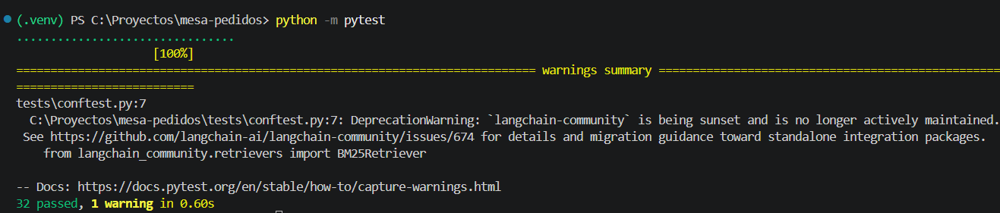
</p>

- El aviso que aparece es de `langchain-community`, que se va a dejar de mantener. No es un error.

<br>

### Corridas reales

#### 1. Armado del índice

- Los 4 PDF quedan en 59 chunks.

<p align="center">
  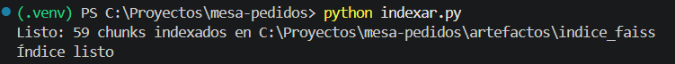
</p>

<br>

#### 2. Consulta con cita (MSG-002)

- Neuquén es zona 5: flete de $175.000 y entrega en 8 a 12 días hábiles, con la cita del PDF de logística.

<p align="center">
  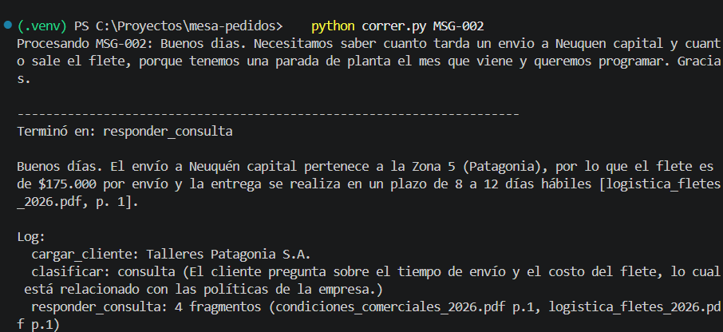
</p>

<br>

#### 3. Pedido confirmado (MSG-009)

- 17% de descuento (12% habitual + 5% por volumen). El cliente es de Córdoba, así que no tiene
  percepciones, y el pedido entra en su crédito.

<p align="center">
  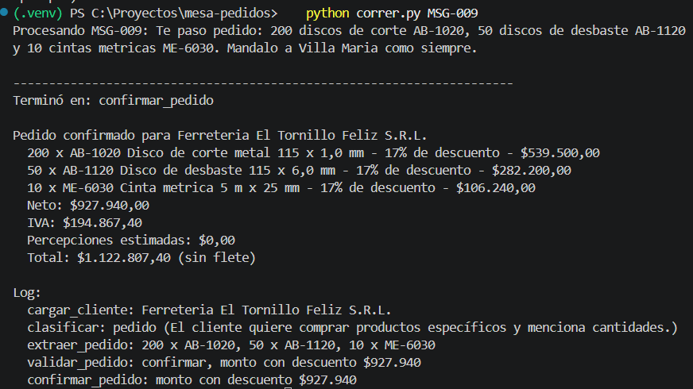
</p>

<br>

#### 4. Cliente suspendido (MSG-017)

- Tiene 95 días de mora y pide a 30 días. Se rechaza directo, sin pasar por Gerencia.

<p align="center">
  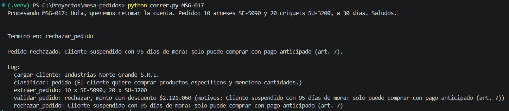
</p>

<br>

#### 5. Pedido en espera de Gerencia (MSG-013)

- El saldo más el pedido supera el límite de crédito. La amoladora Dewalt queda en 15%, el tope de la
  marca. El programa termina y el pedido queda guardado.

<p align="center">
  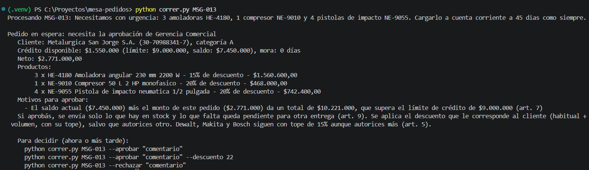
</p>

<br>

#### 6. El mismo pedido aprobado desde otra terminal

- Cerré la terminal y abrí otra. El pedido sigue desde donde se había frenado, por eso no aparece
  "Procesando". Lleva percepción de IIBB (3,5%, el cliente es de Santa Fe) y de IVA (3%, el neto pasa los
  $2.000.000).

<p align="center">
  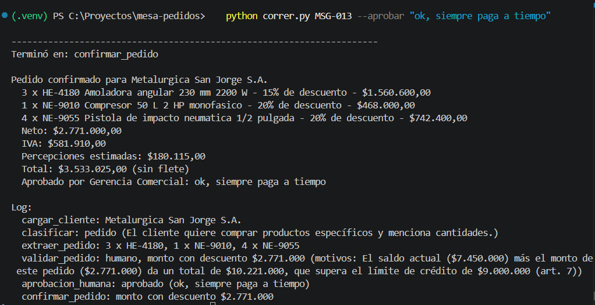
</p>

<br>

#### 7. Pedido rechazado por Gerencia (MSG-014)

- El cliente tiene solo $90.000 de crédito disponible. Gerencia lo rechaza con un comentario.

<p align="center">
  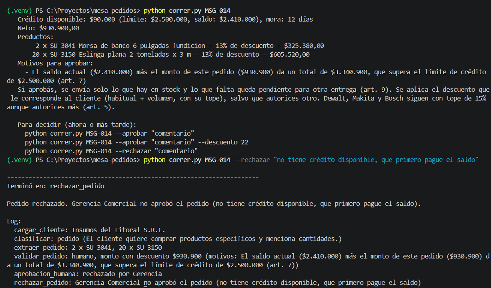
</p>

<br>

#### 8. Pedido aprobado con otro descuento (MSG-016)

- Tenía tres motivos para frenarse: el descuento, el stock y el crédito. Gerencia autoriza 22%: los discos
  van al 22% y las Dewalt siguen en 15%. Se mandan 52 amoladoras y quedan 8 pendientes.

<p align="center">
  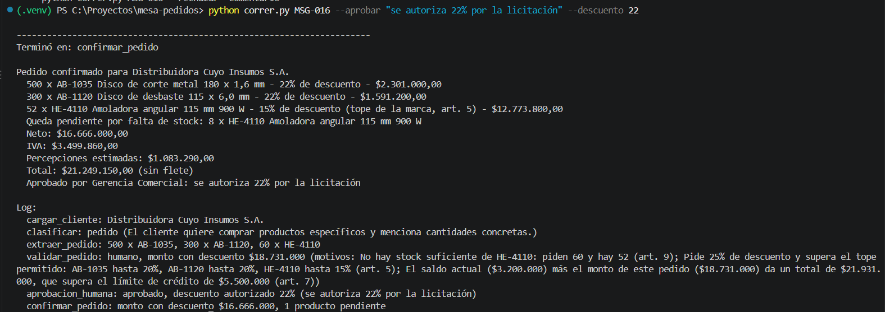
</p>

<br>

#### 9. Medición con búsqueda híbrida

<p align="center">
  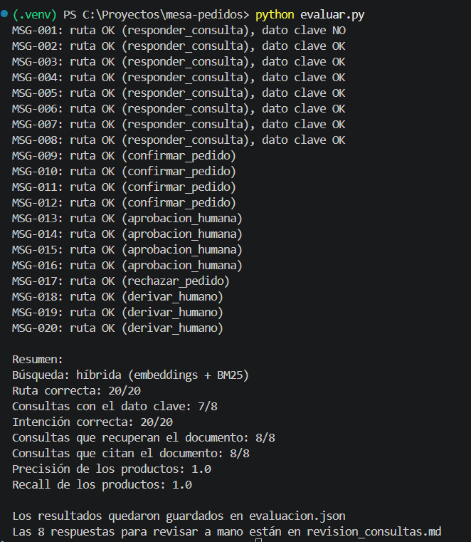
</p>

<br>

#### 10. Medición solo con embeddings

<p align="center">
  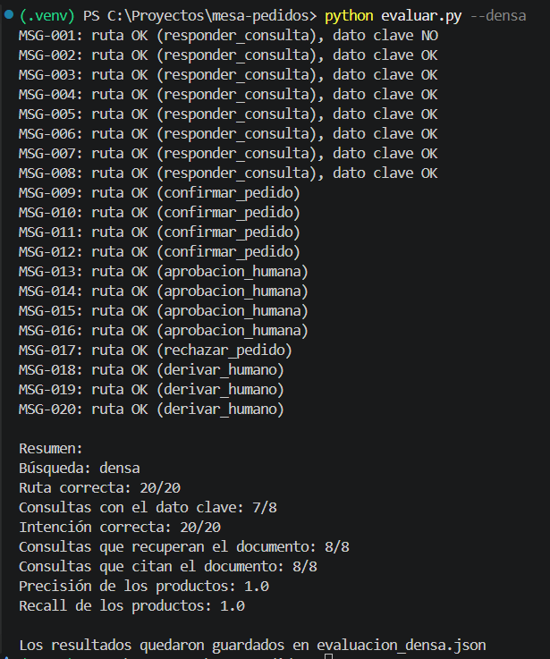
</p>

<br>

---

## 💬 Conceptos Clave

**Un grafo en lugar de un solo prompt:** cada mensaje sigue un camino distinto y cada paso tiene una
responsabilidad. En un grafo cada paso es un nodo y los caminos están declarados, y eso permite dibujarlos,
probarlos y medirlos. Si todo estuviera en un prompt, no habría forma de saber en qué paso se equivocó el
modelo.

**Búsqueda híbrida:** es juntar dos búsquedas. La densa (embeddings) compara el significado: encuentra
"plazo de entrega" aunque el cliente escriba "cuánto tarda". BM25 compara las palabras: encuentra
`HE-4330` exacto. `EnsembleRetriever` combina los dos rankings: un chunk que aparece arriba en las dos
listas queda primero.

**`interrupt()` y no `input()`:** con `input()` el programa queda abierto esperando que alguien escriba.
Con `interrupt()` el grafo guarda su estado en el checkpointer y **el programa termina**. La decisión puede
llegar en otra terminal o al otro día, y el grafo sigue desde el mismo punto con `Command(resume=...)`.

**Structured output:** el LLM contesta con una forma fija (un modelo de Pydantic) y no con texto libre. Si
la respuesta no tiene esa forma, falla en el momento. Con eso no hace falta leer el texto del modelo con
`json.loads` ni adivinar qué quiso decir.

**Golden set:** es la respuesta correcta de cada mensaje, escrita antes de medir. Sin eso, decir que el
sistema "funciona" es una opinión. Con los 20 casos se ve cómo se porta con todos y no solo con los tres
que uno prueba a mano.


<br>

---

## 🚧 Limitaciones

- La confirmación es simulada: no reserva stock ni factura.
- El flete no se suma al pedido; se responde como consulta.
- Las percepciones son estimadas: la de IIBB se aplica a todos los clientes de fuera de Córdoba porque no
  está el padrón.
- Gerencia puede cambiar el descuento al aprobar, pero no las cantidades.
- Cuando falta stock, el art. 9 permite entrega parcial, cambiar el producto o dar de baja el ítem. Solo
  está la entrega parcial, que se puede resolver sin hablar con el cliente.
- Los días hábiles no tienen en cuenta los feriados.
- Si Gerencia aprueba sin autorizar otro descuento, se aplica el que le corresponde al cliente con sus
  topes. En el MSG-016 pidió 25% y le quedan 20% en los discos y 15% en las Dewalt. Que el cliente acepte
  esos descuentos se resuelve hablando con él, fuera del sistema.
- Cuando falta stock, Gerencia ve antes de aprobar cuánto daría el neto con lo que hay. Si con eso el
  pedido quedara debajo del mínimo (art. 3), el sistema no lo vuelve a frenar: se toma como parte de lo
  que aprobó Gerencia.
- En las consultas, el LLM hace las cuentas con montos, como el descuento del MSG-001.

<br>

---

## 📝 Conclusiones

Lo que mejor funcionó fue separar lo que hace el LLM de lo que hace Python. En los pedidos, `reglas.py` hace
todas las cuentas: todos salieron por la ruta correcta y los montos se pueden revisar a mano contra el
catálogo. Los errores aparecieron justo donde el modelo tuvo que razonar solo: comparar un monto con una
tabla (MSG-001) o cruzar dos partes de un PDF (MSG-006 y MSG-007).

También aprendí que una medición automática puede dar bien aunque la respuesta esté mal. Leer las
respuestas una por una mostró dos errores que el dato clave no detectaba.

<br>

---

## 🛠️ Tecnologías Utilizadas

### Herramientas

- **Visual Studio Code**: desarrollo y edición del código.
- **Git / GitHub**: control de versiones y repositorio.
- **OpenAI Platform**: API key y crédito para los modelos.

### Lenguaje

- `Python 3.13`

### Librerías

- `langgraph`: el grafo, los routers e `interrupt()`.
- `langgraph-checkpoint-sqlite`: el checkpointer en SQLite.
- `langchain-openai`: el LLM y los embeddings de OpenAI.
- `langchain-community` y `langchain-classic`: FAISS, BM25 y `EnsembleRetriever`.
- `langchain-text-splitters`: el corte de los artículos muy largos.
- `faiss-cpu`: el índice de embeddings.
- `rank-bm25`: la búsqueda por palabras.
- `pypdf`: la lectura de los PDF.
- `pydantic`: los modelos del structured output.
- `pandas`: la lectura de los CSV.
- `python-dotenv`: la lectura del `.env`.
- `pytest`: los tests.

### Modelos

- `gpt-4o-mini`: clasificar, extraer el pedido y responder las consultas.
- `text-embedding-3-small`: los embeddings de los chunks.

<br>

---

## ✒️ Autora

<p align="left">
  <a href="https://github.com/Aiello-M">
    <br>
    <sub>Mariana Aiello</sub>
  </a>
</p>

<br>

---

<div align="center">
  <p>ICARO · UNC · FCEFyN - Diplomatura en IA Engineering - Desafío 1</p>
</div>
