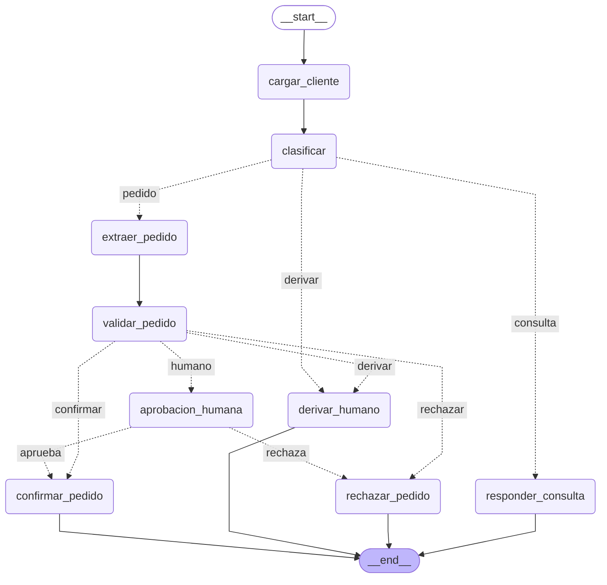

<div align="center">
  <h1>Mesa de Pedidos</h1>
  <h3>Desafío 1 - Curso AI Engineering (ICARO)</h3>
  <p>Mariana Aiello</p>
  <br>
  
  
  
  
  
</div>

<br>

---

## Datos del proyecto

- **Institución:** ICARO
- **Curso:** AI Engineering
- **Trabajo:** Desafío 1 - Mesa de Pedidos
- **Estudiante:** Mariana Aiello

<br>

---

## Qué hace

Un grafo de LangGraph que procesa los mensajes que mandan los clientes de una distribuidora de
insumos industriales. Para cada mensaje:

1. busca al cliente por su CUIT;
2. decide si es una **consulta**, un **pedido** o algo para **derivar** a una persona;
3. si es una consulta, la responde con los 4 PDF de la empresa y cita el documento y la página;
4. si es un pedido, lo arma con el catálogo y el crédito del cliente, aplica las condiciones
   comerciales y lo confirma, lo rechaza o **lo deja en espera para que lo apruebe Gerencia**.

El LLM se usa para entender el texto. Los montos, los descuentos y las reglas los calcula Python.

<br>

---

## 1. Cómo correrlo

Hace falta Python 3.13 y una API key de OpenAI. En Windows, desde la carpeta del proyecto, en PowerShell:

```powershell
# 1. crear y activar el entorno virtual
py -3.13 -m venv .venv
.\.venv\Scripts\Activate.ps1

# 2. instalar las librerías
python -m pip install -r requirements.txt

# 3. crear el .env a partir del ejemplo y completar OPENAI_API_KEY
Copy-Item .env.example .env

# 4. armar el índice de los PDF (una sola vez)
python indexar.py

# 5. procesar un mensaje y medir los 20
python correr.py MSG-009
python evaluar.py
```

En Linux o Mac: `python3 -m venv .venv`, `source .venv/bin/activate` y `cp .env.example .env`.

Si Windows no deja activar el entorno: `Set-ExecutionPolicy -Scope Process -ExecutionPolicy Bypass`.

Para comprobar que todo quedó bien instalado sin usar la API: `python -m pytest` (32 tests).

> La API de OpenAI se paga por uso: hay que cargar crédito en platform.openai.com (el mínimo es
> US$5). Todas las corridas de este trabajo, con las dos mediciones, gastaron unos centavos.

### Comandos

| Comando                                                                        | Qué hace                                                                                       |
| ------------------------------------------------------------------------------ | ---------------------------------------------------------------------------------------------- |
| `python correr.py MSG-002`                                                     | Una consulta: responde citando el PDF                                                          |
| `python correr.py MSG-009`                                                     | Un pedido que se confirma solo                                                                 |
| `python correr.py MSG-017`                                                     | Un pedido que se rechaza (cliente suspendido)                                                  |
| `python correr.py MSG-013`                                                     | Un pedido que queda en espera: muestra lo que tiene que decidir Gerencia y el programa termina |
| `python correr.py MSG-013 --aprobar "comentario"`                              | Retoma el pedido y lo aprueba (puede ser en otra terminal u otro día)                          |
| `python correr.py MSG-014 --rechazar "comentario"`                             | Retoma el pedido y lo rechaza                                                                  |
| `python correr.py MSG-016 --aprobar "comentario" --descuento 22`               | Lo aprueba con otro descuento                                                                  |
| `python correr.py MSG-013 --estado`                                            | Muestra lo que quedó guardado de ese mensaje                                                   |
| `python correr.py --texto "cuánto sale el flete a Salta" --cuit 30-71455982-2` | Procesa un mensaje escrito a mano                                                              |
| `python evaluar.py`                                                            | Corre los 20 mensajes contra el golden set                                                     |
| `python evaluar.py --densa`                                                    | La misma medición con búsqueda solo por embeddings, para comparar                              |
| `python -m mesa_pedidos.grafo`                                                 | Imprime el grafo en Mermaid                                                                    |

Antes de `--aprobar` o `--rechazar` hay que correr el mensaje solo (ej. `python correr.py MSG-014`)
para que llegue a la espera. Las salidas de estos comandos están en la sección 5.

<br>

---

## 2. El grafo

Salida de `python -m mesa_pedidos.grafo` (GitHub la dibuja sola):



**9 nodos y 3 routers.** Las flechas punteadas son las aristas condicionales. Terminan 4 nodos:
`responder_consulta`, `confirmar_pedido`, `rechazar_pedido` y `derivar_humano` (al que se llega desde
`clasificar` y desde `validar_pedido`). `aprobacion_humana` no termina: espera a Gerencia y después
sigue a confirmar o a rechazar.

| Nodo                 | ¿Usa el LLM? | Qué hace                                                                                         |
| -------------------- | ------------ | ------------------------------------------------------------------------------------------------ |
| `cargar_cliente`     | no           | Busca el CUIT en `clientes.csv`                                                                  |
| `clasificar`         | sí           | Decide si es consulta, pedido o derivar (structured output)                                      |
| `responder_consulta` | sí           | Busca en los PDF y responde citando documento y página                                           |
| `extraer_pedido`     | sí           | Saca los productos, las cantidades, la forma de pago y el descuento que pide (structured output) |
| `validar_pedido`     | no           | Usa las dos tools y las reglas para calcular el pedido y decidir qué pasa                        |
| `aprobacion_humana`  | no           | Frena el pedido con `interrupt()` hasta que Gerencia decida                                      |
| `confirmar_pedido`   | no           | Arma la confirmación con los montos ya calculados                                                |
| `rechazar_pedido`    | no           | Arma el rechazo con el motivo                                                                    |
| `derivar_humano`     | no           | Pasa el mensaje al equipo comercial con el motivo                                                |

Los tres routers (`ruta_por_intencion`, `ruta_por_validacion` y `ruta_post_aprobacion`) solo leen
la decisión que dejó el nodo anterior en el estado. Ninguna bifurcación queda escondida en un `if`
adentro de un nodo.

<br>

---

## 3. Las decisiones y por qué

### 3.1 Qué hace el LLM y qué hace Python

| Pregunta                                  | Quién la resuelve                                | Por qué                                                   |
| ----------------------------------------- | ------------------------------------------------ | --------------------------------------------------------- |
| ¿Qué tipo de mensaje es?                  | LLM (`clasificar`)                               | Hay que entender el texto                                 |
| ¿Qué productos pide y cuántos?            | LLM (`extraer_pedido`)                           | Los clientes escriben como hablan ("200 discos de corte") |
| ¿Qué dice la política sobre esto?         | RAG (`responder_consulta`)                       | Está escrito en los PDF                                   |
| ¿Qué fecha menciona el cliente?           | LLM (`clasificar`)                               | Hay que entender el texto ("el 10 de septiembre")         |
| ¿Sigue vigente el presupuesto?            | Python (`calcular_dias`)                         | Es contar días hábiles, y el LLM se puede equivocar       |
| ¿Hay stock? ¿Entra en el crédito?         | Tools `consultar_producto` y `verificar_credito` | Son datos de los CSV y no se pueden inventar              |
| ¿Cuánto sale y qué descuento le toca?     | Python (`reglas.py`)                             | Tiene que dar siempre lo mismo y poder revisarse          |
| ¿Se confirma, va a Gerencia o se rechaza? | Python (`validar_pedido`)                        | Es la política de la empresa                              |
| ¿A qué nodo se va?                        | Router                                           | Solo pasa una decisión que ya se tomó                     |

Las tools no las llama un agente: las llama `validar_pedido` en todos los pedidos. El crédito y el
stock se revisan siempre.

### 3.2 El RAG

**Un chunk por artículo y no por tamaño fijo.** Primero probé con tamaño fijo
(`RecursiveCharacterTextSplitter` con 1000 caracteres y overlap de 150) y el punto de devoluciones
por arrepentimiento quedaba partido: la regla ("se acepta devolución…") en un chunk y la excepción
de los zapatos de seguridad en otro. Si la búsqueda traía solo el primero, al MSG-003 (que quiere
devolver unos zapatos) se le podía contestar que sí. Como los PDF ya vienen escritos por artículo,
partí por ahí: cada artículo de las condiciones comerciales, cada punto de logística y de
devoluciones y cada ficha técnica es un chunk. Quedan **59 chunks** de entre 136 y 810 caracteres.
`CHUNK_MAX = 1500` queda solo por si algún artículo fuera muy largo. Un artículo que sigue en la
página siguiente queda entero y se cita como "p. 1-2". El pie de página que se repite en todas las
hojas no se indexa. Hay un test que muestra que con tamaño fijo la excepción queda separada.

**Cada chunk empieza con el nombre del documento** (y en las fichas, con el rubro). Así un pedazo
suelto como "Zona 3: $95.000" sigue diciendo de dónde salió.

**Búsqueda híbrida: embeddings + BM25 con `EnsembleRetriever`.** Los embeddings encuentran textos
que dicen lo mismo con otras palabras ("cuánto tarda" con "plazo de entrega"). BM25 busca la palabra
exacta, que es lo que sirve para los códigos: para los embeddings `HE-4330`, `HE-4335` y `HE-4410`
se parecen mucho (es el caso del MSG-004). El tokenizador de BM25 no corta en el guion, así
`he-4330` queda como una sola palabra. Cada búsqueda trae 12 candidatos de cada lado, las dos pesan
lo mismo (0,5 y 0,5) y quedan los 4 mejores. Con `python evaluar.py --densa` se puede comparar contra
la búsqueda solo con embeddings (el resultado está en la sección 4).

**El índice se guarda en disco** (`artefactos/indice_faiss`) y se arma una sola vez con
`python indexar.py`. Si cambian los PDF: `python indexar.py --forzar`.

**El prompt recibe los datos del cliente** (provincia, categoría, condición de IVA), porque varias
respuestas dependen de quién pregunta: la zona de flete o si le corresponde percepción. También
tiene la instrucción de citar `[documento, p. N]` y de decir qué información le falta si el contexto
no alcanza.

**Las fechas.** En el MSG-005, del 20/09, preguntan si "el presupuesto que me pasaron el 10 de
septiembre sigue valiendo". La fecha del mensaje viene en la bandeja. La fecha que menciona el
cliente la saca `clasificar` en la misma llamada (el campo `fecha_mencionada`). Con las dos, Python
cuenta los días corridos y hábiles que pasaron y cuándo vence un presupuesto (5 días hábiles, art. 2):
el del 10/09 venció el 17/09. Ese cálculo se le pasa al LLM para que lo use en la respuesta. Si el
cliente dice algo impreciso ("la semana pasada", como en el MSG-003), el campo queda vacío y no se
calcula nada: es mejor no calcular que calcular con un día inventado.

**Los prompts no usan los mensajes de la bandeja como ejemplos.** Las categorías de `clasificar` salen
de los temas de los PDF y de los tipos de mensaje, pero los ejemplos los escribí yo. Si copiaba las
frases de la bandeja, el sistema iba a andar bien justo con los casos que se usan para medirlo.

**Modelos:** `gpt-4o-mini` con temperature 0 (para que las respuestas sean más estables) y
`text-embedding-3-small`. OpenAI avisó que `gpt-4o-mini` deja de funcionar en la API el 14/01/2027.
Para cambiarlo no hay que tocar el código: alcanza con poner `MODELO_LLM=` y el modelo nuevo en el
`.env`.

### 3.3 Las reglas comerciales

**Los números de la política están en un json.** La escala de volumen, los topes, el pedido mínimo,
el 3% por pago anticipado, los días de mora y los impuestos de `condiciones_comerciales_2026.pdf`
están en `mesa_pedidos/reglas_comerciales.json`, cada uno con su artículo. Los pasé a mano porque
`validar_pedido` tiene que funcionar sin LLM. Si cambia la política, se cambia el json.

**Los montos se calculan con `Decimal`**, porque `float` redondea mal (`0.1 + 0.2` da
`0.30000000000000004`). En los textos se muestran con el formato de los PDF: punto para los miles y
coma para los decimales ($927.940,00).

**El descuento:** el habitual del cliente más el de volumen (art. 4), con un tope de 20% por
producto y de 15% para las herramientas eléctricas Dewalt, Makita y Bosch (art. 5). Si paga
anticipado se suma un 3% que no cuenta para el tope (art. 6).

**Qué decide `validar_pedido`, en este orden:**

1. **Derivar** si no se puede evaluar: el CUIT no es de un cliente, o un producto no existe o no se
   pudo identificar.
2. **Rechazar** si el cliente está suspendido (más de 60 días de mora) y no paga anticipado. El
   art. 7 dice que solo puede comprar con pago anticipado, así que también se rechaza si pide contado.
3. **Mandar a Gerencia** si aparece alguno de estos motivos:
   - el saldo más el pedido supera el límite de crédito (art. 7);
   - tiene de 30 a 60 días de mora, pague como pague, porque el art. 7 dice "cada pedido";
   - pide un descuento mayor al tope de algún producto (art. 5);
   - no hay stock suficiente (art. 9);
   - el neto no llega al pedido mínimo (art. 3: no se rechaza, queda en espera);
   - pide más días de plazo que los que le corresponden, o es categoría C y pide cuenta corriente (art. 6).
4. **Confirmar** si no pasó nada de lo anterior.

**Interpretaciones que tuve que tomar**, porque la política no las dice explícitamente:

- Un cliente categoría C que no dice cómo paga se toma como contado, porque la categoría C no tiene
  cuenta corriente (art. 6).
- Pedir 19% en una amoladora Dewalt va a Gerencia aunque esté debajo del 20% general, porque para
  esa marca el tope es 15%.
- La escala de volumen se calcula con el monto de lista (si se calculara con el monto ya descontado
  sería circular). El crédito, el pedido mínimo y los impuestos se calculan con el monto con
  descuento, que es lo que se factura.

### 3.4 La aprobación de Gerencia

`aprobacion_humana` llama a `interrupt()` con lo que Gerencia necesita para decidir: razón social,
crédito disponible (con el límite y el saldo), mora, neto, productos y motivos. Si falta stock,
también muestra cómo quedaría el pedido con lo que hay. Y explica qué pasa si aprueba: se manda solo
lo que hay en stock y el resto queda pendiente (art. 9), y si autoriza otro descuento, Dewalt,
Makita y Bosch siguen con tope de 15%, porque es un acuerdo con el fabricante.

Cuando Gerencia responde, el nodo **vuelve a calcular el pedido** con el stock real y el descuento
autorizado. Si no hay stock de ningún producto, el pedido se rechaza aunque Gerencia lo haya
aprobado. Cualquier respuesta que no sea un "aprobar" claro se toma como rechazo.

Ejemplo, el MSG-016 aprobado con 22%: los discos van al 22%, las amoladoras Dewalt al 15%, se
mandan 52 amoladoras y quedan 8 pendientes. El neto baja de $18.731.000 a $16.666.000 (captura 8).

### 3.5 Frenar y retomar

El checkpointer es `SqliteSaver` sobre `artefactos/checkpoints.sqlite`, con un `thread_id` por
mensaje (el id, por ejemplo `MSG-013`). `python correr.py MSG-013` llega al `interrupt()`, guarda el
estado y **el programa termina**. Después, en otra terminal, `python correr.py MSG-013 --aprobar`
retoma ese mismo pedido con `Command(resume=...)`. Para las capturas 5 y 6 cerré la terminal y abrí
otra antes de aprobar.

Al retomar, el nodo se vuelve a ejecutar desde el principio, así que antes del `interrupt()` solo
hay lecturas y cálculos que se pueden repetir. Si un mensaje ya se procesó, `correr.py` muestra el
resultado en lugar de procesarlo otra vez.

`evaluar.py` usa un checkpointer en memoria, así las pruebas no se mezclan con los pedidos guardados.

### 3.6 Qué casos fallan y por qué

Las 20 rutas salieron bien. Lo que falla está en las respuestas a las consultas. La medición
automática da **7 de 8** con el dato clave, pero cuando leí las 8 respuestas contra los PDF, solo
**5 de 8** estaban bien. El detalle de cada una está en `revision_consultas.md`.

**MSG-001: falla en la medición y a mano.** El cliente pregunta qué descuento por volumen le toca si
compra por $1.200.000 y si le bonifican el flete. La búsqueda trajo el art. 4 y la respuesta lo cita,
pero dice que le corresponde 0%, como si $1.200.000 estuviera entre $250.000 y $999.999. Es 5%: el
art. 4 dice "entre $1.000.000 y $2.999.999: 5%". También dice que Villa María es zona 1, y es zona 2
(interior de Córdoba). Lo del flete igual le da bien, porque en las zonas 1, 2 y 3 se bonifica desde
el mismo monto ($1.500.000).

El error no es de la búsqueda: el fragmento correcto llegó, y con la búsqueda densa falla igual. El
modelo comparó mal un número contra los rangos de la tabla. Es el mismo motivo por el que los
pedidos se calculan en `reglas.py` y las fechas del MSG-005 en Python: en los pedidos, este error
no puede pasar. Para arreglarlo en las consultas se podría hacer lo mismo que con las fechas: sacar el
monto que menciona el cliente y que Python calcule el descuento. No lo hice. Tampoco cambié el prompt
para que este caso dé bien, porque eso sería ajustar el sistema al golden set.

**MSG-006: la medición lo da por bueno, pero está mal.** Los 12 meses de garantía y lo que no cubre
están bien. El problema es que agrega que el reclamo se hace "dentro de los 10 días corridos desde la
recepción" y que si pasaron, ya no se puede. Ese plazo es del punto 1 de devoluciones (faltantes,
errores de despacho y daños de transporte), no de la garantía (punto 3). Al cliente, que compró hace
8 meses, le da a entender que ya no puede reclamar, y sí puede. Tampoco dice que la garantía se
gestiona en el service oficial de la marca. La pregunta era "cómo es el trámite" y el punto 1 explica
cómo se inicia un reclamo (con remito y foto), así que la búsqueda trajo los dos puntos y el modelo
los mezcló.

**MSG-007: la medición lo da por bueno, pero está mal.** Dice que a Santa Rosa se pueden mandar como
máximo 24 aerosoles. Santa Rosa es La Pampa, que es zona 3, y el límite de 24 es solo para las zonas
4 y 5. Para contestar bien tenía que cruzar dos puntos de logística: el 2 (qué provincia es cada zona)
y el 5 (el límite de los aerosoles). Como en la respuesta aparece "24", la medición lo cuenta como
acierto.

**Qué saco de esto:** buscar el dato clave sirve para saber si la información llegó a la respuesta,
pero no si la respuesta está bien. En MSG-006 y MSG-007 el dato está y la respuesta igual le dice algo
equivocado al cliente. Por eso hice también la revisión a mano.

**Híbrida contra solo embeddings: dieron igual.** 20/20 en la ruta y 7/8 con el dato clave en las dos,
y falla el mismo caso. Creo que es porque en estas 8 consultas las preguntas usan palabras parecidas a
las de los PDF. En el MSG-004, además del código `HE-4330`, el cliente escribe "atornillador de
impacto" y "batería", y con eso los embeddings también encuentran la ficha. Dejé la búsqueda híbrida
porque no empeora nada y sirve cuando el cliente escribe solo el código, pero con estos casos no pude
mostrar que mejore.

Con temperature 0 las respuestas casi no cambian entre corridas, pero no son idénticas. Si se vuelve a
correr `evaluar.py`, algún caso podría dar distinto.

### 3.7 Lo que quedó afuera

- La confirmación es simulada: no reserva stock ni factura.
- El flete no se suma al pedido; se responde como consulta.
- Las percepciones son estimadas: la de IIBB se aplica a todos los clientes de fuera de Córdoba
  porque no está el padrón.
- Gerencia puede cambiar el descuento al aprobar, pero no las cantidades.
- Cuando falta stock, el art. 9 permite entrega parcial, cambiar el producto o dar de baja el
  ítem. Solo está la entrega parcial, que se puede resolver sin hablar con el cliente.
- Los días hábiles no tienen en cuenta los feriados.
- Si Gerencia aprueba sin autorizar otro descuento, se aplica el que le corresponde al cliente con
  sus topes. En el MSG-016 pidió 25% y le quedan 20% en los discos y 15% en las Dewalt. Esos
  descuentos se ven en la confirmación, pero que el cliente los acepte se resuelve hablando con él,
  fuera del sistema.
- Cuando falta stock, Gerencia ve antes de aprobar cuánto daría el neto con lo que hay. Si con eso
  el pedido quedara debajo del mínimo (art. 3), el sistema no lo vuelve a frenar: se toma como
  parte de lo que aprobó Gerencia.
- En las consultas, las cuentas con montos (como el descuento del MSG-001) las hace el LLM.

<br>

---

## 4. Los números

`python evaluar.py` guarda el detalle en `evaluacion.json` y `python evaluar.py --densa` en
`evaluacion_densa.json`. La revisión a mano está en `revision_consultas.md`.

| Medición                                             | Búsqueda híbrida | Solo embeddings |
| ---------------------------------------------------- | :--------------: | :-------------: |
| **Ruta correcta** (de 20)                            |      **20**      |     **20**      |
| **Consultas con el dato clave** (de 8)               |      **7**       |      **7**      |
| Intención correcta (de 20)                           |        20        |       20        |
| Consultas que recuperan el documento esperado (de 8) |        8         |        8        |
| Consultas que citan el documento esperado (de 8)     |        8         |        8        |
| Precisión / recall de los productos                  |    1,0 / 1,0     |    1,0 / 1,0    |
| Respuestas correctas revisadas a mano (de 8)         |        5         |                 |

Los dos números que pide la consigna son los dos primeros. Los otros sirven para ver dónde está el
problema cuando algo falla: si la búsqueda no trajo el documento, si el modelo no lo citó o si se
equivocó con lo que tenía.

**Lo que más tiempo me llevó:** completar.

<br>

---

## 5. Corridas

#### 1. Armado del índice

- Los 4 PDF quedan en 59 chunks.

<p align="center">
  
</p>

<br>

#### 2. Consulta con cita (MSG-002)

- Neuquén es zona 5: flete de $175.000 y entrega en 8 a 12 días hábiles, con la cita del PDF de logística.

<p align="center">
  
</p>

<br>

#### 3. Pedido confirmado (MSG-009)

- 17% de descuento (12% habitual + 5% por volumen). El cliente es de Córdoba, así que no tiene
  percepciones, y el pedido entra en su crédito.

<p align="center">
  
</p>

<br>

#### 4. Cliente suspendido (MSG-017)

- Tiene 95 días de mora y pide a 30 días. Se rechaza directo, sin pasar por Gerencia.

<p align="center">
  
</p>

<br>

#### 5. Pedido en espera de Gerencia (MSG-013)

- El saldo más el pedido supera el límite de crédito. La amoladora Dewalt queda en 15%, el tope de
  la marca. El programa termina y el pedido queda guardado.

<p align="center">
  
</p>

<br>

#### 6. El mismo pedido aprobado desde otra terminal

- Cerré la terminal y abrí otra. El pedido sigue desde donde se había frenado, por eso no aparece
  "Procesando". Lleva percepción de IIBB (3,5%, el cliente es de Santa Fe) y de IVA (3%, el neto
  pasa los $2.000.000).

<p align="center">
  
</p>

<br>

#### 7. Pedido rechazado por Gerencia (MSG-014)

- El cliente tiene solo $90.000 de crédito disponible. Gerencia lo rechaza con un comentario.

<p align="center">
  
</p>

<br>

#### 8. Pedido aprobado con otro descuento (MSG-016)

- Tenía tres motivos para frenarse: el descuento, el stock y el crédito. Gerencia autoriza 22%: los
  discos van al 22% y las Dewalt siguen en 15%. Se mandan 52 amoladoras y quedan 8 pendientes.

<p align="center">
  
</p>

<br>

#### 9. Medición con búsqueda híbrida

<p align="center">
  
</p>

<br>

#### 10. Medición solo con embeddings

<p align="center">
  
</p>

<br>

---

## 6. Tests

`python -m pytest` corre 32 tests sin API key. Cambian las llamadas al LLM por las respuestas del
golden set, así que prueban todo lo que no es el modelo: las tools, las reglas, los chunks, las
rutas de los 20 mensajes, lo que recibe Gerencia y cortar y retomar con SQLite. También hay casos
que no están en el golden set, como 38 días de mora pagando anticipado, 19% en una Dewalt, un
cliente suspendido que pide contado o un descuento inválido de Gerencia.

Que los tests pasen no quiere decir que el LLM conteste bien: eso lo mide `evaluar.py`.

<p align="center">
  
</p>

El aviso que aparece es de `langchain-community`, que se va a dejar de mantener. No es un error.

<br>

---

## 7. Estructura

```text
mesa-pedidos/
│
├── config.py                 # rutas, modelos y parámetros
├── indexar.py                # arma el índice
├── correr.py                 # procesa un mensaje y maneja la aprobación de Gerencia
├── evaluar.py                # mide los 20 mensajes contra el golden set
├── requirements.txt
├── .env.example              # copiar como .env y poner la API key
├── evaluacion.json           # resultado de la medición híbrida
├── evaluacion_densa.json     # resultado de la medición solo con embeddings
├── revision_consultas.md     # las 8 respuestas revisadas a mano
├── README.md
│
├── mesa_pedidos/
│   ├── datos.py                  # lee catalogo.csv y clientes.csv
│   ├── indexado.py               # parte los PDF en chunks y arma el índice FAISS
│   ├── retriever.py              # búsqueda híbrida (embeddings + BM25)
│   ├── tools.py                  # consultar_producto y verificar_credito
│   ├── reglas_comerciales.json   # números de la política, cada uno con su artículo
│   ├── reglas.py                 # cálculo y validación del pedido (sin LLM)
│   ├── esquemas.py               # modelos de Pydantic para el structured output
│   ├── llm.py                    # los prompts de clasificar, extraer y responder
│   ├── estado.py                 # el estado del grafo (con el log y su reducer)
│   ├── nodos.py                  # los 9 nodos
│   └── grafo.py                  # routers, StateGraph y SqliteSaver
│
├── datos/                    # los datos del desafío, sin cambios
├── tests/                    # 32 tests que
```
